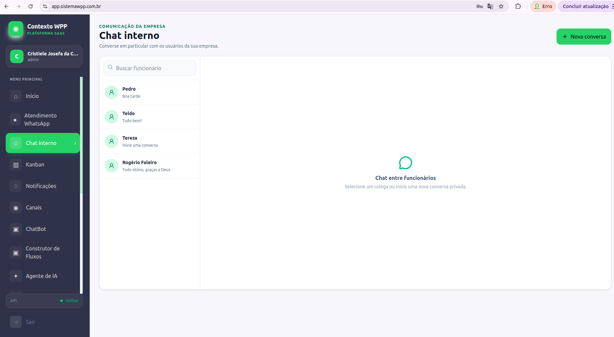
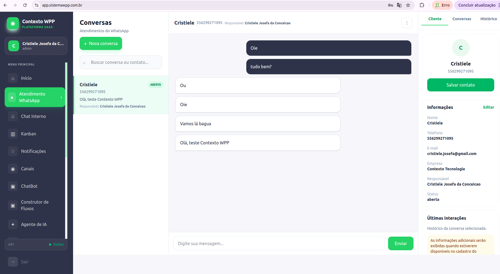

# Contexto WPP
### Plataforma SaaS de Multiatendimento

## Sobre o projeto

O Contexto WPP é uma plataforma SaaS desenvolvida para centralizar o atendimento de empresas em um único número de WhatsApp, permitindo que múltiplos atendentes gerenciem conversas por meio de uma interface web.

O projeto tem como objetivo organizar o atendimento, facilitar a gestão de equipes e melhorar o acompanhamento das conversas com clientes.

## Principais funcionalidades

- Autenticação e gerenciamento de usuários.
- Cadastro e gerenciamento de empresas.
- Organização de atendentes e departamentos.
- Gerenciamento de conversas.
- Transferência de atendimentos entre usuários.
- Histórico de mensagens.
- Estrutura preparada para integração com WhatsApp Business.

## Tecnologias utilizadas

**Front-End**
- React.js
- JavaScript
- HTML5
- CSS3
- Tailwind CSS

**Back-End**
- Node.js
- Express.js

**Banco de dados**
- PostgreSQL
- Supabase
- Prisma

**Infraestrutura e ferramentas**
- Git e GitHub
- Linux
- VPS
- Nginx
- PM2

## Desenvolvimento

O projeto envolve desenvolvimento Full Stack, estruturação de funcionalidades, integração entre Front-End e Back-End, gerenciamento de dados e publicação de aplicações web.

## Objetivo profissional

Este projeto representa minha experiência prática na construção de aplicações web e soluções SaaS, aplicando conhecimentos de Engenharia de Software, desenvolvimento Front-End, Back-End e integração de sistemas.

---

## Demonstração visual

### 1. Painel administrativo

### 2. Chat interno

### 3. Dashboard do atendente

### 4. Atendimento WhatsApp

---

**Desenvolvido por Cristiele Josefa da Conceição**

**Desenvolvido por:** Cristiele Josefa da Conceição

Desenvolvedora Full Stack Júnior | React | JavaScript | Node.js
